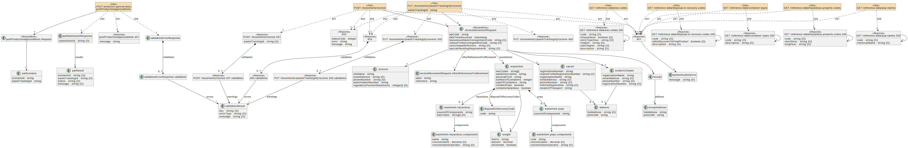

# Receipt of Waste - API Specification

Are you a waste receiver or software provider and want to get involved? [Sign up for our Digital Waste Tracking Service](api-register-as-a-software-provider.md). 

These APIs are currently in Public Beta stage. They may be updated to reflect changes to policy, legislation and user feedback.

We are designing waste tracking APIs to be flexible and accommodate differences in business processes, allowing for:

- separate submission of waste collection and receipt data, whilst maintaining a connection between the two
- differences in data requirements
- data to be submitted in any order (e.g. receipt before collection)

## Open API specification
The swagger specification is published on the Swagger API hub:

- [receipt of waste API specification](../apiSpecifications/)

## Recent and Upcoming Changes

### Reporting hazardous and POPs concentrations as a threshold

We are soon adding a new `concentrationOperator` field alongside `concentration` on the hazardous and POPs components in `wasteItems`. This change will allow a concentration to be reported as a threshold as well as an exact measured value.

Where only a limit is known, put the numeric threshold in `concentration` and the symbol in `concentrationOperator`. The `>` symbol is accepted for hazardous components and either `<` or `>` for POPs. Concentrations are still recorded in mg/kg, and the value for `concentration` must be a number greater than zero with no symbol or unit included. Omit `concentrationOperator` when you are reporting an exact value and do not send it when `concentration` is null. A null `concentration` continues to return a 201 response with a warning that a `concentration` value is recommended when `sourceOfComponents` is `PROVIDED_WITH_WASTE`, `GUIDANCE` or `OWN_TESTING`.

This is an enhancement rather than a breaking change, meaning submission via existing integrations can continue without change. This has been introduced in response to user feedback supported by the agency regulators. If your users receive hazardous or POPs waste, we strongly recommend implementing it at your earliest opportunity.

**Known issue:** Sending both `concentration` and `concentrationOperator` as null returns a 400 response stating that the concentration must be specified. Omitting `concentrationOperator` rather than sending it as null, causes the movement to be created with a warning that a value for `concentration` is recommended. A fix is coming in a later release.

Full field descriptions and validation rules are in the [Receipt of waste API specification](../apiSpecifications/).

## API Change Log
The following page lists all of the changes to the API specification since it was first published:

- [receipt of waste API change log](https://github.com/DEFRA/waste-tracking-service/wiki/Receipt-of-Waste-API-Changelog)

 Page last updated on October 21st 2026.
